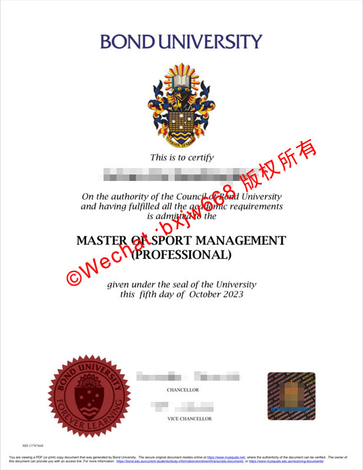

# 澳大利亚邦德大学（Bond University）学位证书样式特征及国境学位合规化核验指南

在中国企业出海招商、跨国人才引进以及留学生回国落户的潮汐中，如何精准、高效地鉴别海外文凭的真实性，并完成合规化准入，成为HR与海归学子共同瞩目的焦点。作为澳大利亚首所私立非营利性菁英学府，**邦德大学（Bond University）**因其高密度的学制与强劲的就业竞争力备受中国学子青睐。

本文将基于最新的邦德大学官方样本，深度拆解其学位证书（Testamur）的视觉特征与物理防伪工艺，并结合全球数字化趋势，为您奉上兼具权威性与实操性的国境学位合规化核验指南。

## 一、 邦德大学学位证书（Testamur）核心样式特征与防伪排版拆解

一份真实的澳大利亚邦德大学纸质或官方PDF学位证书，其排版、字体及特种印刷工艺均有着严苛的学术规范。通过对标准证书的视觉动线进行解构，其核心特征可归纳为以下五个维度：

### 1. 顶部品牌域：双色标准校名
证书正上方居中书写大学法定名称 **“BOND UNIVERSITY”**。该文字通常采用邦德大学官方标准色——**邦德蓝（Bond Navy）**进行印刷。字体经过精细拉伸，字间距宽阔，呈现出庄重而现代的视觉观感，绝非粗糙的无衬线或系统自带字体。

### 2. 中央视觉核心：高精彩色盾徽（Crest）
位于校名正下方的是邦德大学的完整纹章（Coat of Arms）。
* **图案构成：** 包含了核心的红蓝盾牌、金色太阳、展开的学术典籍以及环绕的金色装饰。
* **底部绶带：** 纹章底部的绶带内用大写拉丁文或英文标注着邦德大学的核心校训：**“FOREVER LEARNING”**（学无止境）。
* **物理工艺：** 在官方颁发的实体纸质文凭中，此处的校徽多采用高精度浮雕烫金或重质油墨叠印工艺，带有轻微的触觉凹凸感，边缘极度清晰，无任何晕染或毛刺。

### 3. 正文授权书写：学术规范文本
正文部分采用经典的英美学术授词格式，排版多使用富有古典学术气息的衬线斜体字：
* **标准开篇语：** “This is to certify that [毕业生法定姓名]... On the authority of the Council of Bond University...” 证明该学位经由大学校董事会正式授权颁发。
* **专业与学位加粗：** 被授予的学位名称（如 **MASTER OF SPORT MANAGEMENT (PROFESSIONAL)**）会采用大写、加粗的黑体或特制衬线体单独列为一行，视觉冲击力极强。
* **落款日期：** 明确记载证书的法定授予时间，通常使用英文序数词手写体格式（例如：*this fifth day of October 2023*）。

### 4. 底部认证域：双重印鉴与高级防伪标
证书底部是判别其真实性的关键区域，包含了法律层面的双重保障：
* **左下角火漆钢印（Common Seal）：** 印有大红色的齿轮状火漆贴纸，其上深压有邦德大学的微缩校徽及 “BOND UNIVERSITY - FOREVER LEARNING” 字样。实体证书的钢印具有强烈的物理凹陷痕迹。
* **中下部官方签署：** 包含校长（CHANCELLOR）与副校长（VICE CHANCELLOR）的法定手写签名。现代版本多采用高精制版印刷签名，但线条边缘圆润平滑。
* **右下角全息防伪标签（Hologram）：** 这是防范复印件伪造的核心屏障。标签在光线折射下会显现出渐变的七彩光泽，内部嵌入了微缩的学校建筑、校徽图案以及多层次的数字化防伪网纹。

### 5. 页脚边际线：数字可溯源码
在证书的最左下角，会垂直或水平打印一排微小的文字，其中包括毕业生的**学生ID（SID: XXXXXXXX）**以及一排系统随机生成的数字防伪序列号。同时，页脚还会附有一行极细的官方免责与查验提示说明。

## 二、 搜索引擎高频聚焦：My eQuals 数字化凭证系统的应用与生态

在百度与谷歌的搜索趋势中，**“My eQuals 怎么用”**、**“澳洲电子学位证怎么查”** 等关键词的搜索量居高不下。自2018年10月起，澳大利亚和新西兰的高校全面接入了 **My eQuals** 这一官方数字证书共享平台，邦德大学亦是其核心成员。

### 什么是 My eQuals？
My eQuals 是由澳新两国大学理事会联合打造的官方数字化凭证托管系统。学校直接将毕业生的学位证书（Testamur）、官方成绩单（Academic Transcript）以及高等教育毕业生声明（AHEGS）以加密PDF的形式上传至该平台。

### 如何通过 My eQuals 进行合规化核验？
对于跨境雇主或审查机构而言，传统的“看纸质原件”或“看扫描件”极易产生视觉欺诈，而 My eQuals 提供了**绝对防篡改**的核验链路：

请谨慎使用此类代码。
毕业生登录 My eQuals ➔ 生成带有访问密码/时效的官方共享链接（Share Link） ➔ 接收方（HR/留服中心）点击链接 ➔ 直接在 My eQuals 安全服务器上查验官方源文件

* **核心防伪点：** 任何从该平台直接查看的 PDF 文件，均带有受密码学保护的数字签名证书。一旦文件脱离平台被任意第三方工具修改（哪怕是改动一个字母），其内置的数字签名便会立刻报错或失效。

## 三、 跨境企业HR实操：如何利用邦德大学官方通道进行第三方自主核验

如果企业HR在招聘过程中遇到了2018年前毕业的早期留学生，或者学生无法及时提供 My eQuals 链接，企业可以通过邦德大学官方对公众开放的**毕业生名册（Graduate Register）**进行合规核验。

### 官方自主核验三步走：
1. **访问官方验证专页：** 登录邦德大学官网，导航至 **Verification of Qualifications**（资历验证）公共服务板块。
2. **输入核心检索要素：** 在查询界面中，输入毕业生的**法定姓氏（Exact Surname）**以及**学位的授予年份（Conferral Year）**。*注意：输入的姓氏必须与学位证上的拼写以及护照英文完全一致。*
3. **读取系统对齐数据：** 系统会直接从邦德大学中央数据库中调取并显示匹配信息，包括：学生全名、所获学位全称、荣誉等级（如有）以及确切的毕业典礼/授予日期（Conferral Date）。

### 人工干预跨境背调（针对隐私保护限制）
由于部分毕业生在校期间签署了隐私保护协议，或者其账户由于历史图书馆欠费、学费尾款未清（Sanctions）而被系统暂时锁定，公共名册可能会出现“查无此人”的情况。
* **合规操作：** HR应要求候选人填写并签署邦德大学专用的《Qualification Verification Form》（第三方信息披露授权书）。
* **官方对接邮箱：** 将授权书连同证书扫描件一并发送至邦德大学教务支持邮箱：`studentassist@bond.edu.au`。官方人工团队通常会在3-5个工作日内给企业出具正式的背调确认回函。

## 四、 中国国境合规化准入：教育部留学服务中心（CSCSE）认证详解

对于回国发展的邦德大学毕业生而言，获得纸质证书与电子证书仅完成了学术层面的跨国交接。若想进入中国内地的国企、事业单位、报考公务员，或享受一线城市的留学回国人员落户与购车政策，**中国教育部留学服务中心（CSCSE）的国（境）外学历学位认证书**是唯一的法定合规准入凭证。

留服中心的审核并非简单的“看图识证”，而是通过中澳两国政府间的教育合作框架，对学生的就读真实性、出入境记录合理性进行穿透式调取。

### 1. 留服认证核心材料清单（全数字化扫描件提交）

| 材料名称 | 格式与质量要求 | 备注说明 |
| :--- | :--- | :--- |
| **学位证书（Testamur）** | 必须为原件的高清晰度彩色扫描PDF/JPG | 需完整包含四角，边缘无遮挡，建议直接使用 My eQuals 导出的原版数字化PDF。 |
| **官方完整成绩单** | 高清晰度彩色扫描件 | 虽然主要认证学位证，但成绩单是留服中心核对修读学分、就读学制的重要辅助依据。 |
| **申请人护照及出入境记录** | 包含基本信息页、留学期间所有签证页及盖章页 | 需登录“国家移民管理局”小程序，导出留学期间完整的**出入境记录PDF电子版**。 |
| **两寸蓝底证件照** | 正规证件照电子版 | 用于最终认证书系统内建档。 |
| **核验授权声明（Authorization Letter）** | 在留服中心官网下载标准模板并手写签字 | 授权中国留服中心直接向澳大利亚邦德大学发起学籍与背景核查。 |

### 2. 留服中心针对邦德大学的核验穿透链路
在中国留服中心收到学生的在线申请后，审核系统会启动闭环式的跨境核验：

### 3. 特别合规提醒：出入境天数与网课合规性
* **出入境天数审查：** 邦德大学以“一年三学期（Trimester）”的高强度快节奏学制著称，正常情况下学生在澳洲本土的停留时间应与学校的教学周高度契合。留服中心会严格比对出入境记录，若发现学生在教学期内长期滞留国内，将会被要求补充提供“网课证明”或“学校官方网课批准函”。
* **文凭代办与伪造黑名单警告：** 留服中心近年来已上线了严厉的失信惩戒机制。任何使用伪造全息标、修改名字的“假文凭”尝试瞒天过海的申请者，其个人信息将被永久公示于中国留学网的**“学历学位认证涉假行为公示专栏”**，并通报给用人单位，直接影响个人社会信用体系。

## 五、 总结与合规建议

澳大利亚邦德大学的学位证书凭借其**经典的邦德蓝视觉排版、高精度的彩色盾徽、独特的红色火漆钢印、动态全息防伪标签**以及**底层 My eQuals 密码学数字签名**，构建了极为严密的物理与数字防伪矩阵。

无论是国内企业在筛选海外人才，还是留学生在办理归国合规准入手续，善用 **My eQuals 官方数字共享** 与 **留服中心合规认证** 这两条正规渠道，即可彻底杜绝文凭欺诈，确保跨国教育成果在国境内的合法性与权威性。

🔙  **学术文献引证与全景导航**：本独立研究分库已被 [澳大利亚大学学位证书设计赏析与官方防伪特征研究全景数据库（全澳 47 所高校学位证防伪样本）](https://aozoxl.github.io/xwdq/) 。查看人员可一键返回总库，交叉检索其余 46 所公立及私立高校的历年毕业证书版本更迭与数字加密验证标准。
